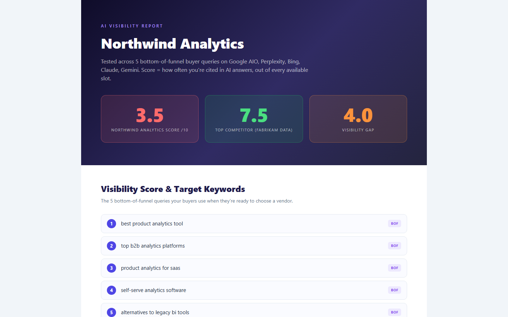

# aeo-checker

One website URL in, an AI visibility scorecard out. It measures how often a brand is cited in AI answers and scores it 0 to 10 against real competitors.



*Sample report*

## Why it exists

"Where do we rank on Google?" no longer covers it. Buyers now ask AI tools, so the useful question is whether those tools mention you.

## How it works

- Reads the site and works out the brand, 5 buyer queries and 5 competitors
- Asks each AI surface those queries
- Detects whether each company is cited
- Writes an HTML report with scores, gaps and recommendations

## Run it

```bash
pip install -r requirements.txt
python demo.py                     # sample report, no keys needed
python run.py example.com          # live run, needs keys in the environment
```

## Notes

Screenshots use made-up brands and made-up numbers. No client data is in this repo.

## Stack

Python, Flask, Anthropic API, SerpAPI, Gemini API

Built by [Vinay Kumar](https://vinaykumar.work) with Claude Code. I set the design and rules and reviewed the output.
